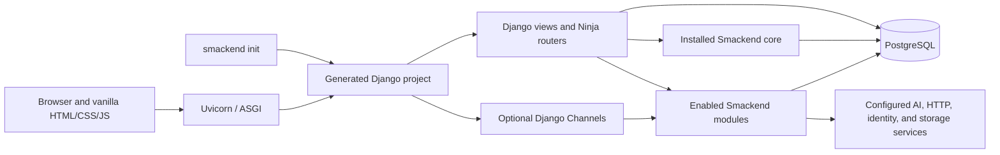

# Smackend

**v0.1.0a9 · Alpha · Production qualification pending**

Smackend is a reusable backend toolkit for Django, Django Ninja, and PostgreSQL. Its CLI generates a small project that imports shared infrastructure from the installed package. The generated application owns its settings, models, migrations, routes, permissions, and frontend.

Smackend is built for prototypes, hackathons, and developing full-stack applications. Its goals are to shorten setup, keep infrastructure understandable and testable, and let application developers add business features with ordinary Django APIs.

## Architecture



The stack uses Python 3.11–3.12, Django 5.2 LTS, Django Ninja, PostgreSQL through psycopg 3, and Uvicorn. The generated Compose file provisions PostgreSQL 17.9 for local development. The frontend requires no JavaScript build step. Optional modules use Django allauth, Pillow, django-storages, HTTPX, JSON Schema, and Channels where applicable. [Architecture](ARCHITECTURE.md) · [Framework evaluation](FRAMEWORK_EVALUATION.md)

## Core and optional modules

| Flag | Capabilities | Automatically enables |
|---|---|---|
| Core scaffold | Validated settings, native PostgreSQL pools and migrations, liveness and readiness, API errors, diagnostics, and project verification | — |
| `--auth` | Browser sessions, configurable registration and sign-in, Argon2 password hashing, account lifecycle, application permissions, and optional OTP delivery and linked Google sign-in | — |
| `--storage` | Managed private or public files, owner-scoped changes, quotas, local storage, and optional S3-compatible storage | Auth |
| `--admin` | Native Django admin with recent reauthentication, role controls, and audit records | Auth |
| `--http` | Named outbound providers with timeouts, bounded requests and responses, explicit retry policy, and ASGI worker-owned clients | — |
| `--ai` | Provider adapters, text and streaming, structured output, tools, embeddings, supported media, and PostgreSQL usage controls | Auth and HTTP |
| `--realtime` | Authenticated point-to-point WebSockets, bounded relay, offline PCM demo, and optional Gemini Live | Auth |

Flags select settings, routes, and dependency extras at generation time. For an existing project, follow the applicable phase guide when adding an extra, registering its routes, configuring its environment, or applying migrations. S3 requires the `s3` extra and backend configuration. Live Gemini voice also requires AI and its provider settings. [Identity](PHASE_2A.md) · [Storage, admin, and HTTP](PHASE_2.md) · [AI and real-time](PHASE_3.md)

## Quick start

Install Git, Python **3.11 or 3.12**, and [uv](https://docs.astral.sh/uv/getting-started/installation/). For the Compose quickstart, start Docker Desktop with Linux containers on Windows, or Docker Engine with the Compose plugin on Linux. An existing PostgreSQL instance is also usable. Port 55432 is the development database default, and the server example uses port 8000.

Run the following in **Windows PowerShell** or a **Linux shell**. uv manages the virtual environment in either shell. These commands check out the GitHub a9 tag and build its wheel locally.

```sh
git clone --branch v0.1.0a9 https://github.com/Andro-HM/Smackend.git
cd Smackend
uv build
mkdir .local
cd .local
uv tool run --from ../dist/smackend-0.1.0a9-py3-none-any.whl smackend --version
uv tool run --from ../dist/smackend-0.1.0a9-py3-none-any.whl smackend init private-notes --auth
cd private-notes
uv sync --find-links ../../dist --python 3.11
docker compose up -d --wait postgres
uv run python manage.py migrate
uv run smackend verify
uv run python -m uvicorn config.asgi:application --host 127.0.0.1 --port 8000 --lifespan auto --no-proxy-headers --no-access-log
```

Open the app at `http://127.0.0.1:8000/`, API docs at `/api/docs`, or the account page at `/account/`. Use `smackend init my-app` for a plain scaffold or `smackend init my-app --storage --admin --ai --realtime` for a combined example with offline features at `/assist/`. Use the same `uv tool run --from` prefix when running from a local wheel. Choose one initialization command for a new project directory. Add business models and routes in the generated project.

Install the CLI from an existing local wheel with `uv tool install ./dist/smackend-0.1.0a9-py3-none-any.whl`, then run `smackend init my-app`. When syncing the generated app, point `--find-links` to the directory containing that wheel. The CLI also works with a local source distribution.

## Configuration and database

Initialization generates a private `.env` with development secrets and a safe `.env.example`. Configuration precedence is **process environment → private `.env` → defaults**. The generated `config/env.py` validates input. `config/settings.py` exposes ordinary Django settings. Keep credentials in a private environment and restart after changing settings.

For an existing PostgreSQL instance, set `POSTGRES_DB`, `POSTGRES_USER`, `POSTGRES_PASSWORD`, `POSTGRES_HOST`, and `POSTGRES_PORT`, then continue from `manage.py migrate`. The database must exist and admit the configured role. Use a disposable database server and a database-creating role for the full verification suite. The Compose database uses a named volume. Review `manage.py migrate --plan` before applying changes to an existing database. Use ordinary `makemigrations`, `migrate`, and `test` commands. Production settings require deployment-specific hosts, secrets, HTTPS, and PostgreSQL TLS verification. [Generated configuration guide](src/smackend/template/README.md) · [Phase 1](PHASE_1.md)

### Running multiple local projects with Docker

Run Compose from each generated project's own directory. Use distinct
directory names so Compose assigns each project its own network and
`postgres_data` volume. Before the first startup, set a free
`POSTGRES_PORT` in each project's private `.env`, for example 55432
and 55433. Keep the generated passwords and Django secrets distinct.
Use a different host HTTP port for each Python process. Use separate
browser profiles if both apps use `127.0.0.1`. Browser cookies are
scoped by host and shared across HTTP ports on that host.

```sh
docker compose config --quiet
docker compose up -d --wait postgres
uv run python manage.py migrate --noinput
uv run smackend verify
```

Use `docker compose stop postgres` to pause the database and
`docker compose up -d --wait postgres` to bring it back. Use
`docker compose up -d --wait --force-recreate postgres` to replace its
container while retaining the named volume. A normal `docker compose
down` retains that volume. Reserve `down --volumes` for disposable
data. PostgreSQL uses the `.env` database, role and password to
initialize a fresh volume. Changing those values later requires a
database-side change before reconnecting the app.

## Verification and repository layout

In a generated app, `uv run smackend verify` checks configuration, Django, PostgreSQL connectivity, migration drift, applied migrations, and application tests. From the toolkit checkout, `uv sync --locked --no-editable --all-extras --group integration` and `uv run --no-sync python -m pytest` run the toolkit suite. PostgreSQL integration tests require the smoke variables described in [CONTRIBUTING.md](CONTRIBUTING.md). [Verification contract](PHASE_1.md#automated-verification)

| Path | Purpose |
|---|---|
| [`src/smackend/`](src/smackend/) | Installed CLI, reusable modules, and module migrations |
| [`src/smackend/template/`](src/smackend/template/) | Generated Django project and vanilla frontend |
| [`tests/`](tests/) | Package, generated-project, and integration checks |
| [`experiments/phase0/`](experiments/phase0/) | Historical framework and performance experiment |
| [`experiments/phase4/`](experiments/phase4/) | Qualification harness and sanitized measurements |
| [`pyproject.toml`](pyproject.toml) and [`uv.lock`](uv.lock) | Package metadata and reproducible dependencies |

## Upgrading from a8

Update the Smackend dependency pin to `0.1.0a9` and sync the generated
app against the new wheel. For existing outbound or AI integrations,
wrap the final Django or Channels application with `with_outbound` and
enable ASGI lifespan to share clients across requests. Managed admission
limits apply per named provider per worker. Explicit client ownership
is still supported. This release requires no toolkit schema migration.
[Upgrade instructions](PHASE_4_OPTIMIZATION.md#outbound-http-lifecycle)

## Alpha qualification

The a9 remediation passed **140 regression tests** against PostgreSQL,
plus wheel and source-install scaffolding checks. The installed wheel
also passed all six `smackend verify` checks on Ubuntu WSL2 with
PostgreSQL 17.11. Local checks covered HTTPS cookies and CSRF, direct
WSS session revocation, worker replacement, PostgreSQL interruption,
and restore of a private file and database. A later Docker Desktop
run verified two simultaneous PostgreSQL 17.9 Compose projects,
including session and data persistence through container recreation
and recovery after a database stop.

| Local observation | Result |
|---|---|
| Matched Windows fan-out pilot at 25 offered requests/s | a8 completed 58 of 250 offers inside the window, compared with 248 for a9. Observed p95 fell from 5,653 ms to 169 ms. The variants completed different proportions of offered traffic. |
| Short Windows AI and SSE comparisons | AI completion p95 fell from 4,210 to 97 ms. First SSE event p95 fell from 3,482 to 152 ms. |
| WSL2 100-user, 30-minute soak | 74,960 valid operations, 41.6 operations/s in-window, 229 MiB peak app RSS, 0.55% app RSS growth, and 15 peak DB connections. Integrity reconciliation passed. |
| WSL2 sustained latency | Read/write/aggregate p95 of 3.71/3.76/3.58 s and SSE first-event p95 of 3.86 s all missed their targets. |
| WSL2 real-time | The 40-second, 500-socket test returned 9,647 valid echoes and missed the 100 ms p95 target at 151 ms. The 20-second mixed test held 50 mock duplex calls, matched all 50,000 frames, and completed 500 CRUD operations and 100 logins. |

These shared-host tests used synthetic providers. The independent-load
reference runs, sustained mixed and socket gates, reference PostgreSQL TLS,
production HTTPS/WSS, browser checks, mixed-load recovery and revocation,
and live-provider qualification remain open. Direct Google registration
is still outstanding. Real-time support is point-to-point.
[Remediation results](PHASE_4_OPTIMIZATION.md) ·
[a9 qualification](PHASE_4.md#a9-final-qualification-follow-up) ·
[Local Docker qualification](PHASE_4.md#local-docker-desktop-qualification) ·
[Roadmap](ROADMAP.md)

## Documentation

- [Phase 0 experiment](experiments/phase0/README.md) and [historical results](experiments/phase0/RESULTS.md)
- [Phase 1 core](PHASE_1.md), [Phase 2A identity](PHASE_2A.md), [Phase 2 optional modules](PHASE_2.md), [Phase 3 AI and real-time](PHASE_3.md), and [Phase 4 qualification](PHASE_4.md)
- [Changelog](CHANGELOG.md), [contributing](CONTRIBUTING.md), [security reporting](SECURITY.md), and [licensing review](LICENSING.md)

Smackend is licensed under the [MIT License](LICENSE). Third-party dependencies retain their own licenses. See [LICENSING.md](LICENSING.md) for details.
